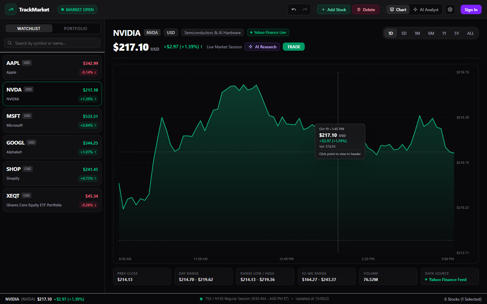
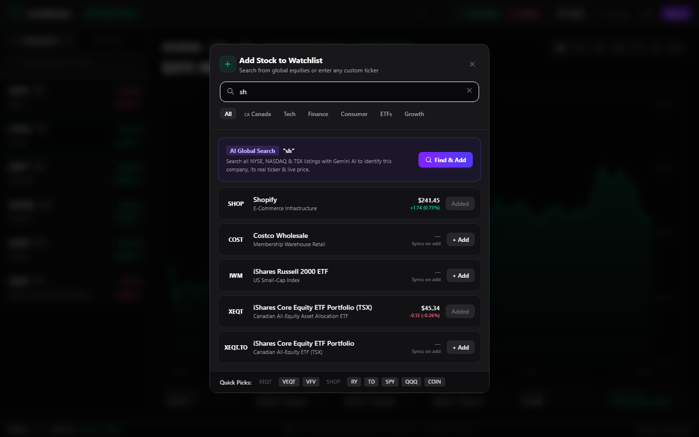
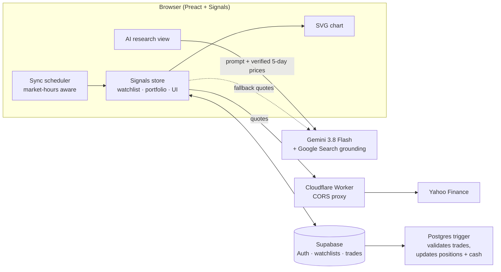

# TrackMarket

[](https://github.com/Tofaluu/track-market/actions/workflows/deploy.yml)
[](LICENSE)

**A stock market dashboard and research terminal for US and Canadian markets.** Build a watchlist of NYSE, NASDAQ, and TSX stocks, watch prices update live during market hours, scrub through interactive charts, generate AI research reports grounded in Google Search, and practice trading with a paper portfolio.

**[Try the live app →](https://trackmarket.dev)** The watchlist and charts work without an account. Sign in to paper trade, and add a free Gemini key for AI research.



<table>
  <tr>
    <td></td>
  </tr>
  <tr>
    <td align="center"><sub>Search a built-in ticker directory, or let Gemini identify any listed company by name</sub></td>
  </tr>
</table>

## Features

- **Live quotes.** Prices refresh every 20 seconds during market hours (9:30 AM – 4:00 PM ET), once a minute outside them, and immediately when you return to the tab. Quotes come from Yahoo Finance, with Gemini as a fallback for anything Yahoo can't price.
- **Interactive charts.** Hand-built SVG charts with a crosshair tooltip, seven timeframes (1D to all-time), a previous-close baseline, and day, 52-week, and volume stats. No charting library.
- **AI equity research.** One click generates a company overview, a 2–5 year outlook, a risk audit, or an explanation of why the stock moved this week. You can also ask your own question. Every report is grounded in a live Google Search.
- **Paper trading.** Sign in to start with $100,000 CAD in paper money. Buy and sell at live prices, track positions and all-time return, review your transaction history, and switch between CAD and USD at the live exchange rate.
- **Cross-exchange search.** Filter a built-in directory of popular stocks and ETFs by category, or type any company name and have Gemini resolve its ticker, exchange, and currency.
- **Undoable watchlist.** Shift-click to multi-select, use keyboard shortcuts, and undo or redo any edit. The watchlist syncs to your account when you're signed in.

## Architecture



### Design decisions

- **No backend of my own.** It's a static app on GitHub Pages. Yahoo Finance doesn't send CORS headers, so quotes go through a small Cloudflare Worker that adds them. In development, the Vite dev server proxies `/api/yahoo` instead. Every quote request tries its endpoints in order with a 4-second timeout.
- **Fine-grained reactivity with Signals.** All state lives in one store ([`src/state.ts`](src/state.ts)) built from `@preact/signals`. A price tick only updates the DOM nodes that read that price, instead of re-rendering the watchlist, so polling every 20 seconds stays cheap.
- **Trades settle in the database.** The client only inserts a row into `transactions`. A Postgres trigger rejects the trade if the user lacks the cash or shares, otherwise it updates `positions` and the cash balance, and the client then reloads its portfolio. The trading rules therefore live in one place.
- **Money is rounded before it's compared.** The ledger is stored in CAD at two decimal places. USD prices are converted and rounded the same way on the trade form and in the portfolio total. Before that, sub-cent differences between the two showed up as small "ghost" profits.
- **Ground the model in real numbers.** The "past week" report fetches Yahoo's 5-day series first and puts the exact start price, end price, and range into the prompt. The model then explains the move instead of guessing it. Every prompt also includes today's date in ET, so the model searches for current facts rather than relying on its training data.
- **Undo as commands.** Watchlist edits and selections are `{ do, undo }` commands ([`src/undo.ts`](src/undo.ts)), and each one also mirrors its change to Supabase. Undoing a delete therefore restores it in your account too.

## Tech stack

| Layer | Tools |
|---|---|
| Frontend | Preact 10, @preact/signals, TypeScript, Vite 7, Tailwind CSS 4, marked |
| Market data | Yahoo Finance chart API via a Cloudflare Worker proxy |
| AI | Google Gemini 3.8 Flash with Google Search grounding |
| Data & auth | Supabase Auth + Postgres (watchlists, positions, transactions) |
| Testing & CI | Vitest, GitHub Actions → GitHub Pages |

## Project structure

```
src/
  state.ts            Signals store: watchlist, portfolio, sync, undo/redo
  undo.ts             command-pattern undo manager
  stocks.ts           stock model and currency detection
  tickerDatabase.ts   built-in directory of US and TSX tickers
  services/
    yahooFinance.ts   quotes and chart series, with endpoint fallback
    gemini.ts         search-grounded quotes, ticker resolution, research prompts
    smartSync.ts      market-hours-aware polling schedule
    supabase.ts       Supabase client
  components/         toolbar, watchlist/portfolio, chart, AI analyst, modals
```

## Running locally

Requires Node.js 22+.

```bash
git clone https://github.com/Tofaluu/track-market.git
cd track-market
npm install
cp .env.local.example .env.local   # add your Supabase URL and publishable key
npm run dev
```

Open http://localhost:5173. Quotes and charts work right away through the dev server's Yahoo proxy. For AI research and name search, get a free key from [Google AI Studio](https://aistudio.google.com/app/apikey) and paste it under the ⚙️ settings button. The key is stored only in your browser and sent directly to Google.

### Keyboard shortcuts

| Key | Action |
|---|---|
| `Delete` / `Shift+D` | Remove selected stocks |
| `Shift+A` | Add a random stock |
| `Shift+C` | Clear selection |
| `Shift+U` / `Shift+R` | Undo / redo |

## Testing

```bash
npm test         # Vitest: sync schedule, Yahoo parsing and fallback, currency detection, undo
npm run build    # type-checks with tsc, then builds
```

Every push to `main` runs the tests, builds, and deploys to GitHub Pages.

## License

[MIT](LICENSE)
